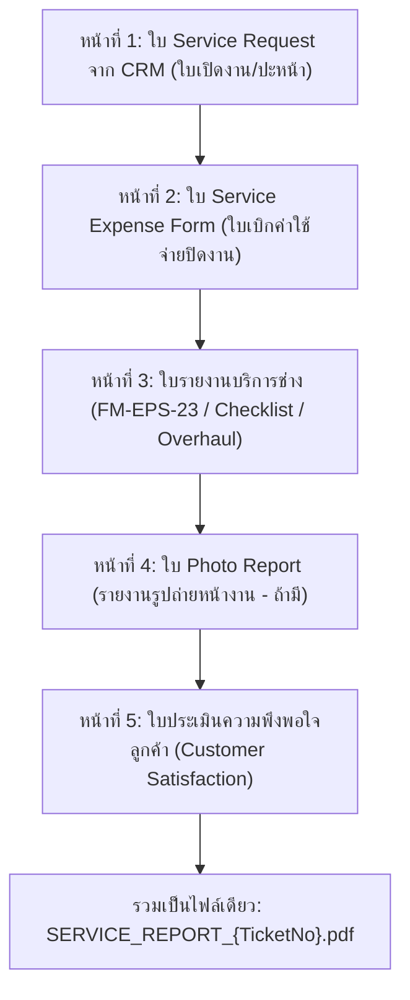

# คู่มือการใช้งานระบบ Siamraj Service Report
**ระบบรายงานงานบริการครบวงจรและรวมเล่มเอกสารมาตรฐาน ISO**

---

## 📌 ข้อมูลระบบและลิงก์สำคัญ (System Quick Links)

* 🌐 **ลิงก์เข้าใช้งานระบบ (Web App Cloud):** [https://service-report-z92a.onrender.com](https://service-report-z92a.onrender.com)
* 📊 **ฐานข้อมูลส่วนกลาง (Google Sheets Database):** [Siamraj Service Report Database](https://docs.google.com/spreadsheets/d/1O25vD9Lczz6wCi5HVz0mK_b7Oj4Y_JlGsdJcGCAaFgQ/edit)
* ☁️ **คลังเก็บไฟล์ PDF (Google Drive Storage):** โฟลเดอร์ `Service_Reports_PDF` บน Google Drive ของบริษัท
* 💻 **ลิงก์ใช้งานสำรองบนเครื่องออฟฟิศ (Local Server):** [http://localhost:8000](http://localhost:8000) (รันผ่านไฟล์ `run_portal.bat`)
* 📦 **ที่เก็บโค้ดระบบ (GitHub Repository):** [https://github.com/siamrajepspump-ux/service-report](https://github.com/siamrajepspump-ux/service-report)

---

## 📑 สารบัญ (Table of Contents)
1. [หมวดที่ 1: คู่มือสำหรับช่างผู้ปฏิบัติงานหน้างาน (Technician Guide)](#หมวดที่-1-คู่มือสำหรับช่างผู้ปฏิบัติงานหน้างาน-technician-guide)
   * 1.1 การเปิดใช้งานและตั้งเป็นไอคอนบนหน้าจอมือถือ (Add to Home Screen)
   * 1.2 การดึงข้อมูลใบงานจาก CRM (Service Request No.)
   * 1.3 การเลือกกลุ่มใบงานที่ต้องใช้ (Form Packages)
   * 1.4 การใช้งาน Photo Report (แนบรูปภาพหน้างาน)
   * 1.5 การกรอกใบเบิกค่าใช้จ่าย (Service Expense Form)
   * 1.6 การทำใบประเมินความพึงพอใจลูกค้า (Customer Satisfaction Form)
   * 1.7 การลงลายมือชื่อบนหน้าจอมือถือ (Digital Signatures)
   * 1.8 การกดบันทึกรายงานฉบับสมบูรณ์ (Submit & Auto-Sync)
2. [หมวดที่ 2: คู่มือสำหรับผู้ดูแลระบบและแอดมิน (Admin Guide)](#หมวดที่-2-คู่มือสำหรับผู้ดูแลระบบและแอดมิน-admin-guide)
   * 2.1 การตรวจสอบข้อมูลใบงานแบบ Real-time บน Google Sheets
   * 2.2 การดาวน์โหลดและเปิดดูไฟล์ PDF รวมเล่มจาก Google Drive
   * 2.3 การแก้ไขเอกสารหรือข้อมูลเมื่อพบข้อผิดพลาด
   * 2.4 การอัปเดตข้อมูลใบงาน CRM ใหม่เข้าระบบ
   * 2.5 การดูแลเซิร์ฟเวอร์คลาวด์ Render
3. [หมวดที่ 3: โครงสร้างเล่มรายงานมาตรฐาน ISO (Document Package)](#หมวดที่-3-โครงสร้างเล่มรายงานมาตรฐาน-iso-document-package)
4. [หมวดที่ 4: คำถามที่พบบ่อยและการแก้ปัญหา (FAQ & Troubleshooting)](#หมวดที่-4-คำถามที่พบบ่อยและการแก้ปัญหา-faq--troubleshooting)

---

## หมวดที่ 1: คู่มือสำหรับช่างผู้ปฏิบัติงานหน้างาน (Technician Guide)

### 1.1 การเปิดใช้งานและตั้งเป็นไอคอนบนหน้าจอมือถือ
ช่างสามารถเปิดใช้งานได้จากโทรศัพท์มือถือ (iPhone, iPad หรือ Android) ทุกรุ่นผ่านสัญญาณ 4G/5G/Wi-Fi:
1. เปิดเบราว์เซอร์บนมือถือ แล้วพิมพ์ลิงก์: **[https://service-report-z92a.onrender.com](https://service-report-z92a.onrender.com)**
2. **วิธีเพิ่มเป็นไอคอนบนหน้าจอมือถือเหมือนแอปจริง (แนะนำ):**
   * **สำหรับ iPhone (Safari):** กดปุ่ม **แชร์ (รูปสี่เหลี่ยมมีลูกศรชี้ขึ้น)** ที่แถบด้านล่าง ➡️ เลื่อนลงมาเลือก **"เพิ่มไปยังหน้าจอโฮม" (Add to Home Screen)** ➡️ กด "เพิ่ม"
   * **สำหรับ Android (Chrome):** กดปุ่ม **จุด 3 จุด (มุมขวาบน)** ➡️ เลือก **"เพิ่มลงในหน้าจอหลัก" (Add to Home screen)** หรือ **"ติดตั้งแอป"**
3. หลังจากนี้ ช่างสามารถกดเปิดจากไอคอนบนหน้าจอมือถือได้โดยตรงทันที

> [!NOTE]
> หากเปิดแอปครั้งแรกของวัน หรือไม่มีคนใช้งานนานเกิน 15 นาที ระบบคลาวด์จะใช้เวลาตื่นประมาณ 30–45 วินาที หลังจากนั้นจะทำงานได้รวดเร็วตลอดทั้งวันครับ

---

### 1.2 การดึงข้อมูลใบงานจาก CRM (Service Request No.)
1. ที่หน้าแรกของแอป ช่องค้นหาด้านบน **"เลขที่คำขอรับบริการ / Request No."**
2. พิมพ์เลขใบงาน CRM เช่น `260024` หรือเลือกจากรายชื่อที่ปรากฏขึ้นมา
3. ระบบจะทำการดึงข้อมูลให้อัตโนมัติ:
   * ชื่อลูกค้า (Customer)
   * โรงงาน/สถานที่ (Plant / Site)
   * รุ่นปั๊ม (Pump Model)
   * หมายเลขเครื่อง (Serial No.)
   * ปัญหาและอาการเบื้องต้น (Detail of work / Symptoms)
   * ผู้แจ้งงาน (Request By) และวันที่นัดหมาย
4. ระบบจะเตรียม **ใบ Service Request จาก CRM** เป็นใบปะหน้าแผ่นแรกให้อัตโนมัติ

---

### 1.3 การเลือกกลุ่มใบงานที่ต้องใช้ (Form Packages)
ระบบออกแบบมาให้ช่างสามารถเลือกฟอร์มได้ตามเนื้องานจริง โดยกดที่ปุ่ม **"+ เพิ่มฟอร์ม"** หรือสลับแท็บด้านบน:
* **`FM-EPS-23` (Service Report):** ใบรายงานบริการมาตรฐาน (สำหรับงานซ่อมทั่วไป, เช็กหน้างาน, ส่งมอบงาน)
* **`FM-EPS-27` (Daily Checklist):** ใบตรวจเช็กสภาพประจำวัน / รายงานเช็กเครื่อง
* **`FM-EPS-26` (Overhaul & Repairs):** ใบงานโอเวอร์ฮอล / ซ่อมใหญ่ในโรงงาน
* สามารถเพิ่มใบงานได้หลายใบหากงานนั้นมีหลายเครื่อง หรือใช้ฟอร์มร่วมกัน

---

### 1.4 การใช้งาน Photo Report (แนบรูปภาพหน้างาน)
ในกลุ่มใบงาน จะมีแท็บ **"Photo Report"** อยู่ด้วยเสมอ:
1. **หากงานนี้มีรูปถ่าย:**
   * ติ๊กเลือกเปิดใช้งาน **Photo Report**
   * สามารถกดถ่ายรูปจากกล้องมือถือ หรือเลือกรูปจากอัลบั้มได้ทันที
   * สามารถใส่คำอธิบายใต้ภาพ (เช่น "สภาพก่อนซ่อม", "เปลี่ยนซีลและแบริ่ง", "ทดสอบรันเครื่องหลังซ่อม")
2. **หากงานนี้ไม่มีรูปถ่าย (เช่น งานบริการด่วน หรืองานเอกสาร):**
   * ช่างสามารถ **ปลดติ๊ก / ไม่เลือกใช้ Photo Report** ได้
   * ระบบจะไม่สร้างหน้ารูปภาพ และจะไม่ทำให้เกิดหน้าว่างในเล่มรายงานฉบับสมบูรณ์

---

### 1.5 การกรอกใบเบิกค่าใช้จ่าย (Service Expense Form)
ก่อนปิดงาน ช่างต้องกรอกใบ **Service Expense** เสมอ เพื่อสรุปค่าใช้จ่าย:
1. คลิกที่แท็บ **"Service Expense"**
2. กรอกข้อมูลค่าใช้จ่ายตามจริง:
   * **ค่าแรงช่าง (Labor Cost):** จำนวนคน x วัน x อัตรา
   * **ค่าทางด่วน (Expressway / Toll fee):** จำนวนเงิน
   * **ค่าน้ำมัน (Fuel / Gas cost):** จำนวนลิตร / จำนวนเงิน
   * **ค่าที่พัก / โรงแรม (Hotel / Accommodation):** จำนวนคืน x อัตรา
   * **เบี้ยเลี้ยง (Allowance):** จำนวนคน x วัน
   * **ค่าอุปกรณ์ / อะไหล่เพิ่มเติมหน้างาน (Equipment / Other expenses)**
3. ระบบจะคำนวณยอดเงินรวมสุทธิให้อัตโนมัติ

---

### 1.6 การทำใบประเมินความพึงพอใจลูกค้า (Customer Satisfaction Form)
เป็นใบสุดท้ายที่ลูกค้าต้องเป็นผู้ประเมินและเซ็นรับมอบงาน:
1. คลิกที่แท็บ **"Customer Satisfaction"**
2. ให้ลูกค้าให้คะแนนหัวข้อการบริการ (เช่น ความตรงต่อเวลา, ความสุภาพ, คุณภาพงานซ่อม, การให้คำแนะนำ)
3. ระบบจะสรุปคะแนนรวม (เต็ม 56 คะแนน) และคิดเป็นร้อยละ (%) ให้อัตโนมัติ

---

### 1.7 การลงลายมือชื่อบนหน้าจอมือถือ (Digital Signatures)
1. **ช่องลายเซ็นช่างผู้ให้บริการ (Service Engineer / Technician):**
   * ช่างใช้นิ้วเซ็นลงบนกรอบสี่เหลี่ยมบนหน้าจอมือถือ
   * พิมพ์ชื่อ-นามสกุล และวันที่ปฏิบัติงาน
2. **ช่องลายเซ็นลูกค้าผู้รับมอบงาน (Customer Acceptance):**
   * ยื่นมือถือให้ลูกค้าตรวจสอบงาน และใช้นิ้วเซ็นรับมอบงานบนหน้าจอ
   * พิมพ์ชื่อผู้รับมอบงานและตำแหน่งของลูกค้า
3. หากเซ็นผิด สามารถกดปุ่ม **"ล้างลายเซ็น" (Clear)** เพื่อเซ็นใหม่ได้ตลอดเวลา

---

### 1.8 การกดบันทึกรายงานฉบับสมบูรณ์ (Submit & Auto-Sync)
เมื่อตรวจสอบข้อมูลครบทุกแท็บแล้ว:
1. กดปุ่มสีเขียวขนาดใหญ่ด้านล่าง:
   👉 **"บันทึกและสร้าง PDF รายงานฉบับสมบูรณ์"**
2. **สิ่งที่ระบบทำให้โดยอัตโนมัติ (ช่างไม่ต้องทำอะไรเพิ่ม):**
   * รวบรวมเอกสารทุกหน้าเข้าด้วยกันตามลำดับ ISO
   * ฝังฟอนต์สารบรรณ (TH Sarabun New) ข้อความ และลายเซ็นต์ลงในพิกัดกระดาษเป๊ะ 100%
   * แปลงเป็นไฟล์ PDF เล่มสมบูรณ์
   * **ส่งข้อมูลสรุปเข้าสู่ Google Sheets ของบริษัททันที**
   * **อัปโหลดไฟล์ PDF ขึ้นสู่ Google Drive ของบริษัททันที**
3. หน้าจอจะแสดงปุ่ม **"เปิดดู PDF"** หรือ **"ดาวน์โหลด PDF"** ให้ช่างเปิดตรวจเช็กหรือส่งให้ลูกค้าดูได้ทันทีครับ

---

## หมวดที่ 2: คู่มือสำหรับผู้ดูแลระบบและแอดมิน (Admin Guide)

### 2.1 การตรวจสอบข้อมูลใบงานแบบ Real-time บน Google Sheets
แอดมินหรือหัวหน้างาน ไม่จำเป็นต้องรอช่างส่งเอกสารทางไลน์:
1. เปิดเข้าไปที่ลิงก์ชีตส่วนกลาง:
   👉 **[Google Sheets: Siamraj Service Report Database](https://docs.google.com/spreadsheets/d/1O25vD9Lczz6wCi5HVz0mK_b7Oj4Y_JlGsdJcGCAaFgQ/edit)**
2. ในแท็บ **`Service_Reports`** จะแสดงรายการใบงานที่ช่างส่งเข้ามาแบบ Real-time:
   * **คอลัมน์ A (Ticket No / Request No):** เลขที่ใบงาน CRM
   * **คอลัมน์ B (Sync Date):** วันและเวลาที่ช่างกดส่งงาน
   * **คอลัมน์ C-D (Customer / Plant):** ชื่อบริษัทลูกค้า และสถานที่ตั้งโรงงาน
   * **คอลัมน์ E-F (Pump Model / Serial No):** รุ่นปั๊ม และหมายเลขเครื่อง
   * **คอลัมน์ G-H (Technician / Service Date):** ชื่อช่างผู้ไปปฏิบัติงาน และวันที่ทำงาน
   * **คอลัมน์ I (Forms Included):** ฟอร์มที่ใช้ในเล่มนั้น
   * **คอลัมน์ J (Total Expense):** สรุปยอดค่าใช้จ่ายที่ขอเบิก
   * **คอลัมน์ K (Satisfaction Score):** คะแนนความพึงพอใจที่ลูกค้าประเมิน
   * **คอลัมน์ L (PDF File Link):** **ลิงก์เปิดดูไฟล์ PDF บน Google Drive (คลิกดูได้ทันที)**

---

### 2.2 การดาวน์โหลดและเปิดดูไฟล์ PDF รวมเล่มจาก Google Drive
แอดมินสามารถดาวน์โหลดหรือพิมพ์ไฟล์ PDF ฉบับสมบูรณ์ได้ 2 ช่องทาง:
1. **คลิกผ่าน Google Sheets:**
   * ในคอลัมน์ L ของแถวใบงานนั้นๆ ให้คลิกที่ลิงก์ Google Drive
   * ไฟล์ PDF ฉบับสมบูรณ์จะเปิดขึ้นมา สามารถกดปุ่ม **พิมพ์ (Print)** หรือ **ดาวน์โหลด (Download)** ได้ทันที
2. **เปิดจากโฟลเดอร์ Google Drive โดยตรง:**
   * เข้าไปที่ Google Drive ของบริษัท
   * เปิดโฟลเดอร์ชื่อ **`Service_Reports_PDF`**
   * จะพบไฟล์ PDF ที่ตั้งชื่อตามเลขใบงาน เช่น `SERVICE_REPORT_260024.pdf`

---

### 2.3 การแก้ไขเอกสารหรือข้อมูลเมื่อพบข้อผิดพลาด
หากช่างกรอกข้อมูลผิดพลาด หรือแอดมินต้องการแก้ไขข้อมูล มีวิธีทำ 2 รูปแบบ:

#### **แบบที่ 1: แก้ไขข้อมูลสรุปทั่วไป (ชื่อ, เบอร์โทร, ยอดเงิน)**
* แอดมินสามารถดับเบิลคลิกแก้ไขข้อความในช่องตารางของ **[Google Sheets](https://docs.google.com/spreadsheets/d/1O25vD9Lczz6wCi5HVz0mK_b7Oj4Y_JlGsdJcGCAaFgQ/edit)** ได้โดยตรงทันที เหมาะสำหรับการแก้ไขตัวเลขบัญชีหรือยอดเบิกเงิน

#### **แบบที่ 2: ต้องการแก้ไขเนื้อหาในเล่ม PDF และออกไฟล์ใหม่**
1. เปิดเว็บแอป [https://service-report-z92a.onrender.com](https://service-report-z92a.onrender.com)
2. พิมพ์ค้นหาเลขใบงานเดิม (เช่น `260024`)
3. ระบบจะดึงข้อมูลที่เคยทำไว้กลับขึ้นมาแสดงบนหน้าจอ
4. แก้ไขข้อมูลที่ต้องการ (เช่น เปลี่ยนตัวเลขค่าใช้จ่าย, เพิ่มรูปถ่าย, แก้ไขข้อความสรุปงาน)
5. กดปุ่ม **"บันทึกและสร้าง PDF รายงานฉบับสมบูรณ์"** อีกครั้ง
6. **ผลลัพธ์:**
   * ระบบจะสร้างไฟล์ PDF เล่มใหม่ที่ถูกต้อง
   * ทำการบันทึกทับไฟล์เดิมบน Google Drive
   * อัปเดตข้อมูลและเวลาล่าสุดในแถวเดิมของ Google Sheets โดยอัตโนมัติ (ไม่สร้างแถวซ้ำซ้อน)

---

### 2.4 การอัปเดตข้อมูลใบงาน CRM ใหม่เข้าระบบ
ระบบดึงข้อมูลใบงานจากไฟล์ `crm_tickets_cache.csv`:
* หากฝ่ายขายหรือส่วนกลางมีรายการใบงาน CRM ชุดใหม่:
  * สามารถนำไฟล์ CSV รายการใบงานใหม่ มาวางทับที่ `data/crm_tickets_cache.csv` ในระบบ
  * หรือบนหน้าเว็บแอป สามารถกดปุ่ม **"โหลดข้อมูล CRM ใหม่"** เพื่อให้ระบบดึงข้อมูลอัปเดตล่าสุดเข้าสู่ระบบค้นหาได้ทันที

---

### 2.5 การดูแลเซิร์ฟเวอร์คลาวด์ Render
* เว็บแอปทำงานอยู่บน [Render Dashboard](https://dashboard.render.com/) ภายใต้ชื่อบริการ **`service-report`**
* **URL สาธารณะ:** `https://service-report-z92a.onrender.com`
* **การอัปเดตโค้ดในอนาคต:** เมื่อมีการปรับปรุงฟอร์มหรือแก้ไขโค้ด เพียงแค่ Push ขึ้น GitHub ที่ `https://github.com/siamrajepspump-ux/service-report` ตัว Render จะดึงไปติดตั้งใหม่อัตโนมัติ (Auto-Deploy) โดยที่แอดมินไม่ต้องทำอะไรเพิ่ม

---

## หมวดที่ 3: โครงสร้างเล่มรายงานมาตรฐาน ISO (Document Package)

เมื่อช่างกดส่งงาน ระบบจะรวมเล่มเอกสารตามลำดับที่ถูกต้องตามข้อกำหนดระบบคุณภาพ ISO ดังนี้:

1. **แผ่นที่ 1 (ใบปะหน้า): Service Request Form**
   * ใบคำขอรับบริการจากระบบ CRM แสดงข้อมูลลูกค้า, นัดหมาย, อาการ, ช่างที่ได้รับมอบหมาย
2. **แผ่นที่ 2: Service Expense Form (FM-EPS-21)**
   * ใบเบิกค่าใช้จ่ายงานบริการ (ค่าแรง, ค่าทางด่วน, ค่าน้ำมัน, ค่าโรงแรม, เบี้ยเลี้ยง) สำหรับฝ่ายบัญชี
3. **แผ่นที่ 3: Service Report Form (FM-EPS-23 / FM-EPS-27 / FM-EPS-26)**
   * บันทึกผลการตรวจเช็ก, รายการอะไหล่ที่เปลี่ยน, การแก้ไขปัญหา และผลการทดสอบเครื่อง
4. **แผ่นที่ 4: Photo Report (ถ้าเลือกเปิดใช้)**
   * ภาพถ่ายความละเอียดสูงก่อนทำ-หลังทำ พร้อมคำบรรยายใต้ภาพ
5. **แผ่นที่ 5 (ใบปิดท้าย): Customer Satisfaction Form (FM-EPS-45)**
   * การให้คะแนนประเมินการบริการของลูกค้า พร้อมลายเซ็นและชื่อ-ตำแหน่งของผู้รับมอบงาน

---

## หมวดที่ 4: คำถามที่พบบ่อยและการแก้ปัญหา (FAQ & Troubleshooting)

### Q1: ช่างเปิดเว็บตอนเช้าแล้วหน้าเว็บหมุนโหลดนานผิดปกติ เกิดจากอะไร?
* **คำตอบ:** เป็นคุณสมบัติของ Cloud Free Tier ของ Render เมื่อไม่มีคนใช้งานนานเกิน 15 นาที ระบบจะเข้าสู่โหมดหลับ (Sleep) เพื่อประหยัดพลังงาน เมื่อมีคนเปิดคนแรกของวัน จะใช้เวลาปลุกตัวเองประมาณ **30–45 วินาที** หลังจากหน้าเว็บโหลดขึ้นมาแล้ว จะทำงานได้รวดเร็วทันทีตลอดทั้งวันครับ

### Q2: ถ้าหน้างานลูกค้าไม่มีสัญญาณอินเทอร์เน็ต ช่างต้องทำอย่างไร?
* **คำตอบ:** 
  1. ช่างสามารถเปิดหน้าเว็บแอปค้างไว้ตั้งแต่ตอนที่มีสัญญาณ
  2. กรอกข้อมูลและถ่ายรูปเก็บไว้ในเครื่อง
  3. เมื่อกลับมาอยู่ในจุดที่มีสัญญาณอินเทอร์เน็ต (4G/5G หรือ Wi-Fi) ค่อยกดปุ่ม **"บันทึกและสร้าง PDF รายงานฉบับสมบูรณ์"** ข้อมูลและรูปทั้งหมดจะถูกส่งขึ้นระบบอย่างสมบูรณ์

### Q3: จะตรวจสอบได้อย่างไรว่า Google Sheets และ Google Drive เชื่อมต่ออยู่หรือไม่?
* **คำตอบ:** บนหน้าเว็บแอป ที่แถบเมนูด้านบน จะมีปุ่ม **"ตั้งค่า Google Sheets"**
  * หากจุดสถานะเป็น **สีเขียวกะพริบ** แสดงว่าเชื่อมต่อออนไลน์พร้อมซิงค์อัตโนมัติ
  * สามารถกดปุ่ม **"🔍 ทดสอบการเชื่อมต่อ"** เพื่อทดสอบส่งสัญญาณเช็กสถานะได้ตลอดเวลา

### Q4: สามารถเปลี่ยนชื่อโดเมนเว็บไซต์เป็นชื่อบริษัทเองได้ไหม (เช่น `service.siamrajpump.com`)?
* **คำตอบ:** ทำได้ครับ! บน Render Dashboard ในเมนู **Settings** ➡️ หัวข้อ **Custom Domains** สามารถใส่ชื่อโดเมนของบริษัทและตั้งค่า CNAME ของโดเมนบริษัทเข้ามาได้ฟรีครับ
